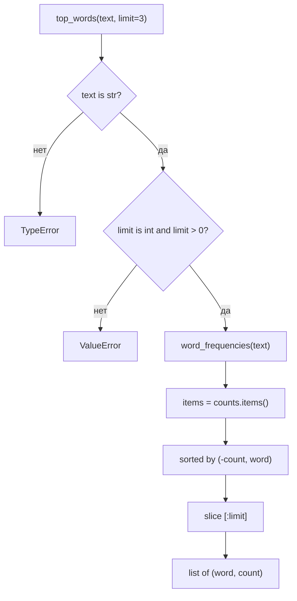

# Design

## Context

См. `proposal.md` — Why. Функция опирается на уже существующую `word_frequencies` из `practices/practice_04/app/metrics.py`. Модуль остаётся набором чистых функций без состояния и внешних зависимостей.

## Goals / Non-Goals

**Goals:**
- Переиспользовать существующий подсчёт частот и не дублировать логику токенизации.
- Зафиксировать детерминированный порядок результата.

**Non-Goals:**
- Не менять `word_frequencies` и её контракт.
- Не добавлять новую зависимость или отдельный модуль.

## Decisions

- **Сортировка ключей кортежем `(-count, word)`.** Один вызов `sorted` даёт нужный порядок без нескольких проходов. Альтернатива — сортировка только по частоте — отклонена, потому что при равных частотах результат зависел бы от порядка вставки.
- **Возврат списка кортежей, а не `dict`.** Список сохраняет порядок и допускает срез по `limit`; словарь в Python 3.7+ тоже упорядочен, но семантически это не ранжирование.
- **Проверка `limit` до вычислений.** Это дешёвая валидация и предсказуемая ошибка.
- **Пустой текст не является ошибкой.** Он естественно даёт пустой список.

## Interaction

## Risks / Trade-offs

- [Пунктуация остаётся частью токена, как и в `word_frequencies`] → Согласовано с предыдущим изменением; расширение вне границ.
- [Сортировка всего словаря O(n log n)] → Приемлемо для библиотечной функции; оптимизация `heapq.nlargest` не нужна без реального профиля.
