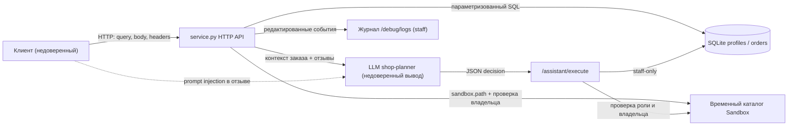

# Модель угроз Mini Shop (practice 6)

Модель построена по мотивам Microsoft Threat Modeling Tool: описание системы, границы доверия, потоки данных, угрозы STRIDE, меры защиты и проверка.

## 1. Описание системы

Mini Shop — локальный учебный HTTP-сервис на Python. Он хранит профили и заказы в SQLite в памяти, читает файлы из временного каталога и принимает решения AI-помощника в формате JSON.

Компоненты:

- `service.py` — HTTP API, авторизация, SQL-запросы, вызов инструментов помощника.
- `sandbox.py` — физическая граница временного каталога (не меняется).
- SQLite `profiles`, `orders` — синтетические данные.
- `app` — нет; фронтенд отсутствует, клиентом выступает HTTP-клиент.
- LLM `shop-planner` — внешний планировщик, возвращает JSON `{tool, arguments}`.
- `/assistant/execute` — исполнитель решений LLM.

Активы: PII профилей, чеки клиентов, служебная заметка, целостность заказов и файлов, токены сессий, журналы.

## 2. Границы доверия

1. **Клиент → HTTP-сервис.** Всё, что приходит в query, body и заголовках, недоверенно.
2. **HTTP-сервис → SQLite.** SQL-запросы должны быть параметризованы.
3. **HTTP-сервис → файловая система.** Доступ ограничен `sandbox.py`, но права внутри каталога проверяет `service.py`.
4. **HTTP-сервис → LLM.** Текст отзывов и заказов попадает в prompt; LLM не является доверенным источником команд.
5. **LLM → исполнитель инструментов.** Решение LLM не даёт новых полномочий; сервер проверяет роль и владельца.
6. **Сервис → журналы.** Журналы не должны содержать пароли и токены.

## 3. Потоки данных

Пунктирная стрелка — атака prompt injection: вредоносный отзыв влияет на LLM, но не должен влиять на права исполнителя.

## 4. Угрозы STRIDE

| ID | STRIDE | Угроза | Вектор | Мера защиты | Проверка |
|---|---|---|---|---|---|
| T1 | Information Disclosure | Чужой профиль по ID | `GET /profile?id=2` без токена | Требовать сессию; клиент видит только свой профиль | `test_profile_requires_auth_and_ownership` |
| T2 | Tampering | SQL-инъекция в профиле | `id=0 OR 1=1` | Параметризованный SQL, `int()` | `test_profile_sql_injection_is_not_executed` |
| T3 | Information Disclosure | SQL-инъекция и перечисление в поиске | `q=' OR '1'='1` | Staff-only + параметризованный `LIKE` | `test_search_is_staff_only_and_parameterized` |
| T4 | Elevation of Privilege | Подмена роли заголовком | `X-Role: staff` без staff-сессии | Роль только из серверной сессии | `test_admin_export_uses_session_role_not_header` |
| T5 | Information Disclosure | Чужой чек | `GET /files?user=bob...` | Проверка владельца каталога | `test_files_are_scoped_to_the_owner` |
| T6 | Information Disclosure | Выход из каталога к заметке | `path=../../private/...` | `sandbox.path` + проверка базового каталога | `test_files_are_scoped_to_the_owner` |
| T7 | Tampering | Подмена цены заказа | `POST /orders {price: 1}` | Цена только из каталога | `test_order_price_comes_from_catalog` |
| T8 | Information Disclosure | Все заказы без авторизации | `GET /orders` | Сессия + фильтр по владельцу | `test_orders_are_scoped_to_the_owner` |
| T9 | Tampering | Stored XSS в отзывах | `<script>` в тексте отзыва | `html.escape` при выводе | `test_reviews_are_html_escaped` |
| T10 | Information Disclosure | Контекст чужого заказа | `GET /assistant/context?order_id=2` | Проверка владельца заказа | `test_assistant_context_is_scoped_to_owner` |
| T11 | Information Disclosure | SQL-инъекция в контексте | `order_id=1 OR 1=1` | `int()` + параметризованный SQL | `test_assistant_context_is_scoped_to_owner` |
| T12 | Information Disclosure | Пароли и токены в журнале | `GET /debug/logs` | Staff-only + редактирование секретов | `test_debug_logs_staff_only_and_redacted` |
| T13 | Elevation of Privilege | Злоупотребление инструментами | `export_profiles`, `read_file` private, `delete_tree` | Проверка роли и владельца в исполнителе | `test_assistant_execute_enforces_roles` |
| T14 | Tampering | Prompt injection через отзыв | Инструкция в тексте отзыва | Недоверенный блок в prompt + серверная авторизация инструментов | `test_prompt_injection_review_cannot_escalate` |
| T15 | Information Disclosure | Утечка внутренних ошибок | Исключение в обработчике | Общий ответ 500 без деталей | `test_internal_error_is_generic` |
| T16 | Spoofing | Отсутствие аутентификации на данных | `/orders`, `/reviews`, `/files` без токена | Единая проверка сессии | Набор `test_security.py` |

## 5. Остаточные риски

- Нет ограничения частоты попыток входа и срока жизни токена — вне границ учебного стенда.
- LLM всё ещё получает недоверенный текст отзывов; защита строится на серверной авторизации, а не на «послушании» модели.
- `sandbox.py` намеренно не менялся: его физическая граница считается доверенной.
- HTTPS, внешнее хранилище и настоящие ПДн не используются.

## 6. Проверка модели

- До исправлений: `evidence/before/attacks.json` — 23 успешных сценария (22 × `200/201`, утечка ошибки `500`).
- После исправлений: `evidence/after/attacks.json` — те же 23 сценария блокируются или нейтрализуются, цена и XSS исправлены, журнал редактирован.
- Реальная модель: `evidence/before/llm/` и `evidence/after/llm/` — модель `ollama/itmo-agent`, агент `shop-planner`; принудительный `export_profiles` до фикса `200`, после `403`.
- Автотесты: `python -m unittest -v` → 29 tests OK (на Windows symlink-тест пропускается).
